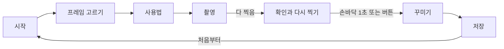

# 도토리네컷


브라우저에서 노트북 카메라로 네컷 사진을 찍고, 꾸미고, 저장하는 웹 앱입니다. 숭실대학교 미디어앤테크 기말 팀 프로젝트입니다.

사진, 영상, 올린 이미지는 모두 브라우저 안에서만 처리합니다. 어디에도 업로드하지 않습니다.

## 주요 기능

- **손바닥으로 시작:** 손바닥을 1초 펴면 3, 2, 1 카운트다운과 플래시로 연속 촬영이 시작됩니다. 버튼이나 스페이스 바로도 찍을 수 있습니다. 브이는 신호가 아니라 포즈로 마음껏 쓰면 됩니다.
- **프레임 4종:** 4컷(1×4), 6컷(2×3), 4컷 두 장(2×4, 같은 사진 두 줄), 8컷(2×4).
- **얼굴 필터:** 강아지, 안경, 볼터치. 촬영할 때 얼굴을 따라 움직이고 사진과 GIF, 영상에 함께 들어갑니다.
- **다시 찍기:** 다 찍은 뒤 원하는 칸만 골라 다시 찍습니다. 손바닥을 1초 펴면 꾸미기로 넘어갑니다.
- **꾸미기:**
  - 프레임 색 8가지와 직접 고르기
  - 테마 5종(기본, 도토리 숲, 숭실대 캠퍼스, 레트로 픽셀, 가을 낙엽)
  - 배경 사진
  - 색 필터 4종
  - 스티커: 기본 스티커 6종, 내 이미지를 올리면 배경을 자동으로 지운 스티커
  - 날짜와 문구
- **저장:** PNG, 움직이는 GIF(가로 400px, 10fps, 3초), 영상 WebM(30fps, 약 6초).

## 화면 흐름



사용법 페이지는 새로 시작할 때 한 번 나옵니다. 촬영 화면 헤더의 물음표 버튼으로 다시 볼 수 있습니다.

## 실행하기

Node.js 20 이상과 Chrome이 필요합니다. 노트북 내장 카메라 기준으로 만들었고, 화면은 1280×800에 맞췄습니다.

```bash
npm install
npm run dev      # http://localhost:5173
npm run build    # 타입 검사와 프로덕션 빌드
npm run preview  # 빌드 결과 미리 보기
```

처음 촬영 화면에 들어가면 브라우저가 카메라 권한을 묻습니다. 손과 얼굴 인식 모델(ml5.js)은 처음 한 번 인터넷에서 불러옵니다.

## 기술 스택

- Vite, React 19, TypeScript
- Tailwind CSS v4, shadcn/ui(Radix), Radix Colors 팔레트(포인트 색 #7B481E)
- p5.js 1.x 인스턴스 모드: 카메라 미리보기와 촬영
- ml5.js 1.x: handPose(손 제스처), faceMesh(얼굴 필터)
- zustand(상태), motion(애니메이션), gifenc(GIF), MediaRecorder(WebM)
- 글꼴: Pretendard Variable(앱에 포함)

## 폴더 구조

```
src/
  screens/       화면별 폴더: start, frame, guide, shoot, decorate, save
  lib/           공용 로직
    gesture.ts   손바닥과 브이 판정, 1초 유지 추적
    face.ts      얼굴 필터 그리기
    layouts.ts   레이아웃과 칸 위치 계산
    compose.ts   최종 사진 합성(프레임, 테마, 필터, 스티커, 글자)
    cutout.ts    스티커 배경 자동 제거
    filters.ts   색 필터
    export.ts    PNG, GIF, WebM 저장
  store/useApp.ts  앱 전체 상태
  components/    공용 UI(shadcn 컴포넌트, 헤더와 단계 표시)
public/
  brand/         로고, 캐릭터, 사용법 그림, 스티커
  frames/        테마별 프레임 이미지
docs/            흐름 문서, 설계 문서, 기획서 수정사항
```

## 팀 역할

| 담당 | 맡은 부분 | 코드 위치 |
|---|---|---|
| A | 촬영과 저장 | `src/screens/shoot/`, `src/screens/save/`, `src/lib/export.ts` |
| B | 제스처와 얼굴 필터 | `src/lib/gesture.ts`, `src/lib/face.ts`, `src/screens/shoot/useDetection.ts` |
| C | 스티커와 필터 | `src/screens/decorate/`, `src/lib/cutout.ts`, `src/lib/filters.ts` |
| D | 화면 흐름과 프레임 | `src/screens/start/`, `src/screens/frame/`, `src/screens/guide/`, `src/lib/layouts.ts`, `src/lib/compose.ts` |

## 문서

- [`docs/user-flow.md`](docs/user-flow.md): 화면 흐름과 결정 기록(v1~v4)
- [`docs/architecture.md`](docs/architecture.md): 구조, 상태, 모듈 설명
- [`docs/기획서-수정사항.md`](docs/기획서-수정사항.md): 기획서 v0.2에서 바뀐 점

## 알려진 한계

- WebM 영상은 일부 앱에서 재생되지 않습니다. 공유할 때는 GIF를 권합니다.
- 조명이 어둡거나 손이 화면 가장자리에 있으면 손 인식이 늦을 수 있습니다. 버튼과 스페이스 바는 항상 동작합니다.
- 아직 없는 기능(P1): 지우개 보정, 셔터 소리, 사람 누끼, 왕눈이 필터.

## 출처와 라이선스

- 글꼴: [Pretendard](https://github.com/orioncactus/pretendard), SIL Open Font License 1.1(`src/assets/fonts/Pretendard-LICENSE.txt`)
- 캐릭터, 사용법 그림, 스티커, 프레임 그림은 팀이 만든 캐릭터를 바탕으로 Google Gemini 이미지 모델(Nano Banana Pro)로 생성했습니다.
- 숭실대 캠퍼스 테마는 위키미디어 공용의 캠퍼스 사진을 참고해 새로 그렸습니다. 원본 사진은 저장소에 포함하지 않았고, 학교 로고와 교표는 쓰지 않았습니다.
- 손과 얼굴 인식: [ml5.js](https://ml5js.org/)
