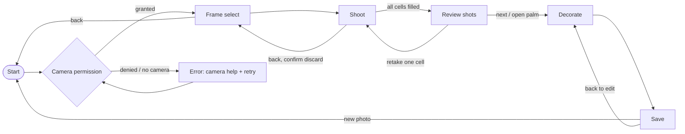

# Dotori 4Cut — User Flow (v1, approved 2026-11-23)

Source: team 기획서 (planning + PRD v0.2, artifact 7SPaHc372X9uTy9C9x8iFr) plus HANDOFF_dotori-4cut.md.
Where the two disagree, the 기획서 wins unless the user decides otherwise (see "Open decisions").

Target: first-time user finishes shoot → decorate → save in under 2 minutes with no instructions.
Screen size: 1280x800, Chrome, built-in laptop camera. State key: `app.screen`.

## Main flow

## Screens

### 1. Start (`start`)
- Dotori 4Cut logo + character, one large primary button "촬영 시작".
- One-line privacy notice: photos never leave this browser.
- Clicking the button triggers `getUserMedia`. While ml5 models load, show a loading state on the button, not a blocking screen.
- Errors (required by PRD): camera denied, no camera found, model load failed. Each shows a fix hint and a retry button.

### 2. Frame select (`frame`)
- Three layout cards with a live thumbnail and shot count:
  - 1x4 strip, 600x1800, 4 shots
  - 2x3 grid, 1200x1800, 6 shots
  - 2x4 grid, 1200x1800, 4 shots (optional 8-shot toggle)
- Selecting a card sets the number of shots. Primary "다음" button.

### 3. Shoot (`shoot`)
- Large live mirror preview on the left; on the right the empty frame with cells filling as shots are taken.
- Start triggers: button, Space bar, or V-sign held 1 s (progress ring fills; 3 s cooldown; "제스처 끄기" toggle).
- Per shot: 3-2-1 countdown → white flash → shot drops into its cell. Continuous until all cells are filled.
- Face filters (dog ears+nose, glasses, blush) are picked here on the live preview so they are baked into the shot and the 1.5 s motion clip.
- Gesture detection pauses during the countdown (performance risk in PRD).

### 3b. Review (still `shoot`, sub-state)
- All shots shown in the frame. Click a cell → "다시 찍기" retakes that cell only.
- "꾸미러 가기" primary button, or open-palm gesture (P1).

### 4. Decorate (`decorate`)
Canvas preview of the composed frame in the center; tool panel on the right with tabs:
- 프레임: color (8 presets + picker), background image, preset themes (기본, 도토리 숲, 숭실대 캠퍼스, 레트로 픽셀).
- 필터: 4 color filters, applied to all shots.
- 스티커: upload image → auto background removal (tolerance slider 0–120) → move, resize, rotate, layer order, delete (Delete key).
- 글자: date stamp on/off, custom text (auto black/white contrast).
- "저장하기" primary button.

### 5. Save (`save`)
- Final strip "rolls out" once (motion).
- Three export buttons: PNG (≤1 s), GIF (400 px, 10 fps, 3 s, progress bar), WebM (~6 s, 30 fps).
- Note under WebM: may not play in some apps, use GIF for sharing.
- "처음부터" (back to Start, clears state) and "다시 꾸미기".

## Cross-cutting
- Dev fps counter top-left (hidden in demo mode).
- Error toasts: unsupported upload file type, recording not supported.
- Keyboard: Space = shoot, Delete = remove selected sticker, Esc = deselect.

## Decisions (all approved by user 2026-11-23)
1. Layouts: 기획서 says 1x4 / 2x3 / 2x4. Handoff said 4-cut strip + 2x2. Draft follows the 기획서.
2. Print PDF (4x6 with cut lines): handoff lists it, 기획서 puts printing out of scope. Draft drops it.
3. Face filters: 기획서 lists them under decorate; draft moves them to Shoot so they track the live face and land in GIF/video.
4. Timer 3/5/10 s (handoff) vs fixed 3-2-1 (기획서). Draft keeps fixed 3 s.
5. Frame themes (도토리 숲, 숭실대, 레트로): placed as presets inside Decorate > 프레임, not a separate step.
