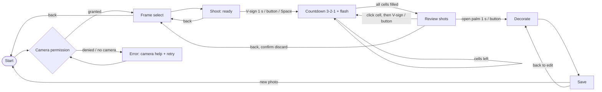

# Dotori 4Cut — User Flow (v2, approved 2026-11-23)

v2 changes from v1 are marked **[v2]**. v1 and v2 both approved by the user.

Source: team 기획서 (planning + PRD v0.2, artifact 7SPaHc372X9uTy9C9x8iFr) plus HANDOFF_dotori-4cut.md.
Where the two disagree, the 기획서 wins unless the user decides otherwise (see "Open decisions").

Target: first-time user finishes shoot → decorate → save in under 2 minutes with no instructions.
Screen size: 1280x800, Chrome, built-in laptop camera. State key: `app.screen`.

## Main flow

## Screens

### 1. Start (`start`)
- Dotori 4Cut logo + character, one large primary button "촬영 시작".
- One-line privacy notice: photos never leave this browser.
- Clicking the button triggers `getUserMedia`. While ml5 models load, show a loading state on the button, not a blocking screen.
- Errors (required by PRD): camera denied, no camera found, model load failed. Each shows a fix hint and a retry button.

### 2. Frame select (`frame`)
- **[v2]** Four cards, each a selectable option (no hidden toggle). Label leads with the shot count, plain words, no "스트립/그리드" jargon:
  - 4컷 / 세로로 긴 한 장 (1x4, 600x1800)
  - 6컷 / 두 줄에 여섯 장 (2x3, 1200x1800)
  - 4컷 두 장 / 똑같이 두 장, 나눠 갖기 좋아요 (2x4, each shot repeated in both columns)
  - 8컷 / 두 줄에 여덟 장 (2x4, eightShotMode)
- Title "몇 컷 찍을까요?", one helper line "고른 칸 수만큼 찍어요." Primary "다음" button.

### 3. Shoot (`shoot`)
- Large live mirror preview on the left; on the right the empty frame with cells filling as shots are taken.
- **[v2] Ready state is "listening" from the moment the screen opens.** Hand detection starts as soon as the camera is ready; the user does NOT press anything first. Any one of three triggers starts the whole sequence: V-sign held 1 s, the "촬영 시작" button, or Space.
- **[v2] Say it on screen, big.** The main line of the ready state is the instruction itself, e.g. "브이 하면 바로 찍어요" with "버튼이나 스페이스 바도 돼요" as the secondary line. Not a small pill in a corner.
- **[v2] Show that the hand is seen.** States the user can see on the preview:
  1. model loading: "손 인식 준비 중" (button and Space already work)
  2. no hand: the instruction above
  3. hand seen but not a V: a light outline/hint near the hand ("브이를 만들어 보세요")
  4. V held: a progress ring around the hand fills over 1 s, then the countdown starts
  5. cooldown after a trigger (3 s): ring hidden, short "잠시만요"
- Gesture switch label "제스처" (on = gestures used). When off, the main line becomes "버튼이나 스페이스 바로 찍어요".
- Per shot: 3-2-1 countdown → white flash → shot drops into its cell. Continuous until all cells are filled.
- Face filters (dog ears+nose, glasses, blush) are picked here on the live preview so they are baked into the shot and the 1.5 s motion clip.
- Gesture detection pauses during the countdown (performance risk in PRD).

### 3b. Review (still `shoot`, sub-state)
- All shots shown in the frame. Click a cell → "다시 찍기" retakes that cell only (button, Space, or V-sign).
- "꾸미러 가기" primary button, or open palm held 1 s.
- **[v2]** Same visibility rule as ready: the main line says "손바닥을 펴면 꾸미러 가요", and the ring fills on the open palm.

### 4. Decorate (`decorate`)
Canvas preview of the composed frame in the center; tool panel on the right with tabs:
- 프레임: color (8 presets + picker), background image, preset themes (기본, 도토리 숲, 숭실대 캠퍼스, 레트로 픽셀).
- 필터: 4 color filters, applied to all shots.
- 스티커: upload image → auto background removal (tolerance slider 0–120) → move, resize, rotate, layer order, delete (Delete key).
- 글자: date stamp on/off, custom text (auto black/white contrast).
- "저장하기" primary button.

### 5. Save (`save`)
- Final strip "rolls out" once (motion).
- Three export buttons: PNG (≤1 s), GIF (400 px, 10 fps, 3 s, progress bar), WebM (~6 s, 30 fps).
- Note under WebM: may not play in some apps, use GIF for sharing.
- "처음부터" (back to Start, clears state) and "다시 꾸미기".

## Cross-cutting
- Dev fps counter top-left (hidden in demo mode).
- Error toasts: unsupported upload file type, recording not supported.
- Keyboard: Space = shoot, Delete = remove selected sticker, Esc = deselect.

## Decisions (v1, approved by user 2026-11-23)
1. Layouts: 기획서 says 1x4 / 2x3 / 2x4. Handoff said 4-cut strip + 2x2. Draft follows the 기획서.
2. Print PDF (4x6 with cut lines): handoff lists it, 기획서 puts printing out of scope. Draft drops it.
3. Face filters: 기획서 lists them under decorate; draft moves them to Shoot so they track the live face and land in GIF/video.
4. Timer 3/5/10 s (handoff) vs fixed 3-2-1 (기획서). Draft keeps fixed 3 s.
5. Frame themes (도토리 숲, 숭실대, 레트로): placed as presets inside Decorate > 프레임, not a separate step.

## v2 changes (approved by user 2026-11-23)
6. 8컷 is its own card on Frame select; the toggle is gone. (User request.)
7. Frame select copy: count-first labels, no jargon, no keyboard instructions as the helper line. (User feedback: copy felt awkward.)
8. Shoot ready state listens for the V-sign immediately and says so in large text, with visible hand feedback. (User expected V to start shooting right away and did not know it was supposed to.)
